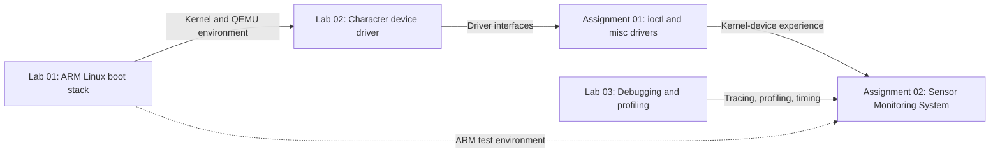

# LOS201 — Linux Operating System / Embedded Linux

Coursework repository covering ARM Linux boot, kernel modules, Linux driver interfaces, debugging, profiling, and a multi-threaded sensor-monitoring application.

## Course information

| Item | Details |
|---|---|
| **Course** | LOS201 |
| **Class** | IC2008 |

## Team members

| No. | Full name | Student ID |
|---:|---|---|
| 1 | Trần Gia Phúc | SE204417 |
| 2 | Trần Hoàng Khôi | SE203155 |
| 3 | Trần Nguyễn Việt Dũng | SE205180 |
| 4 | Thân Trọng Khang | SE203290 |
| 5 | Nguyễn Huy Khánh | SE204207 |

**Target platform:** ARMv7 Cortex-A9 emulated with QEMU `vexpress-a9`  
**Main technologies:** Linux 5.15, U-Boot 2022.04, BusyBox 1.35.0, C, Linux kernel APIs, POSIX threads, and IPC.

## Block diagram — Course project roadmap



This is a **learning and implementation roadmap**, not a claim that these projects form one executable program. Each linked folder contains its own architecture block diagram.

## Projects

| Project | Focus | Evidence and details |
|---|---|---|
| [Lab 01](lab_1/README.md) | Cross-compile the kernel and U-Boot; construct a BusyBox root filesystem and initramfs; boot QEMU | Saved kernel configuration and boot artifacts |
| [Lab 02](lab_2/README.md) | Character device with `read`/`write`, `/proc`, `/sys`, and BusyBox init integration | Driver source, test scripts, initramfs |
| [Lab 03](lab_3/README.md) | GDB remote debugging, Valgrind, `strace`, `perf`, and latency experiments | Debugging sessions, profiler logs, histogram |
| [Assignment 01](assignment_1/README.md) | Four `ioctl` commands and an atomic counter misc device | Test scripts, kernel logs, 30/30 and 31/31 recorded checks |
| [Assignment 02](assignment_2/README.md) | Sensor Monitoring System with four worker threads and POSIX message queues | Source, host profiling logs, Valgrind report |

## Repository layout

```text
LOS201/
├── README.md
├── lab_1/          # ARM Linux / U-Boot / BusyBox boot artifacts
├── lab_2/          # Character driver and initramfs
├── lab_3/          # Debugging, profiling and real-time analysis
├── assignment_1/   # ioctl and misc counter drivers
└── assignment_2/   # Sensor driver and multi-threaded application
```

Each folder contains its own instructions and links to the source code or evidence. Paths in those instructions are relative to the repository root unless otherwise noted.

## Clone and inspect

```bash
git clone https://github.com/trangiaphuc05022006-eng/LOS201.git
cd LOS201

# Git LFS is used for some tracked file types (notably .ko).
# If Git LFS is installed, restore LFS-managed content:
git lfs install
git lfs pull
```

> A clone does **not** contain every original build tree. For example, the Lab 01 Linux kernel source tree and the unpacked BusyBox source are not committed. Prebuilt output files and configuration snapshots are available in `lab_1/`. Rebuilding requires obtaining source releases separately and setting up a matching Linux host and toolchain.

## Development environment

- Linux host with `make`, `gcc`, `qemu-system-arm`, `cpio`, and standard build utilities.
- ARM cross-toolchains: `arm-linux-gnueabihf-` for Lab 02; `arm-linux-gnueabi-` appears in the Assignment 01/02 driver Makefiles. Check toolchain, ABI and kernel compatibility before rebuilding.
- The kernel module Makefiles point to `$(HOME)/embedded_lab1/kernel/linux-5.15`. Adjust `KDIR` to your own **configured and built** Linux kernel source tree.
- Additional tools for Lab 03/Assignment 02: GDB, Valgrind, `strace`, and `perf`.

For a practical entry point, use the [Lab 01 boot artifacts](lab_1/README.md) first, then follow the relevant project README.

## Selected repository evidence

- [Lab 03: GDB session](lab_3/logs/gdb_session.txt) and [Valgrind after fixes](lab_3/logs/valgrind_fixed.txt).
- [Assignment 01: ioctl tests](assignment_1/logs/test_asgn1_output.txt) and [counter tests](assignment_1/logs/test_counter_output.txt).
- [Assignment 02: Valgrind report](assignment_2/logs/valgrind_sms.txt), [strace summary](assignment_2/logs/strace_sms.txt), and [perf report](assignment_2/logs/perf_sms.txt).

**Evidence convention:** Log statements in these READMEs describe checked-in records. They are not a claim that all projects were rebuilt or rerun from a fresh clone.

## Notes

- The code and artifacts belong to coursework and may include contributions from multiple repository contributors. Authorship of individual files is recorded in file headers and commit history.
- Results are environment-dependent, especially real-time scheduling and profiling metrics.
- This material is published for learning and demonstration. Cite sources and do not submit another contributor's work as your own.
