# Assignment 01 — Linux Device Drivers: ioctl and Misc Device

Two ARM Linux kernel drivers demonstrate different interfaces: an `ioctl`-enabled character device and a misc-device counter. The assignment includes userspace tooling, functional tests, kernel logs, and a report.

## Course information

| Item | Details |
|---|---|
| **Course** | LOS201 |
| **Class** | IC2008 |

## Team members

| No. | Full name | Student ID |
|---:|---|---|
| 1 | Trần Gia Phúc | SE204417 |
| 2 | Trần Hoàng Khôi | SE203155 |
| 3 | Trần Nguyễn Việt Dũng | SE205180 |
| 4 | Thân Trọng Khang | SE203290 |
| 5 | Nguyễn Huy Khánh | SE204207 |

## Block diagram — Two Linux device-driver implementations

```mermaid
flowchart TB
    subgraph TASK1["Task 1: ioctl character device"]
        TOOL["asgn1_ctl and test_asgn1.sh"]
        DEV1["/dev/asgn1 (major 241)"]
        OPS1["asgn1_driver: read / write / unlocked_ioctl"]
        BUF["Mutex-protected 1024-byte buffer and statistics"]
        CMD["RESET_BUFFER / GET_STATS / SET_MODE / GET_VERSION"]
        TOOL --> DEV1 --> OPS1
        OPS1 -->|"read and write"| BUF
        OPS1 -->|"ioctl commands"| CMD
        CMD <--> BUF
    end

    subgraph TASK2["Task 2: misc counter device"]
        TEST2["cat / echo / test_counter.sh"]
        DEV2["/dev/counter (misc major 10)"]
        OPS2["counter_driver: read / write"]
        ATOM["atomic_t counter and access totals"]
        PROC["/proc/counter_info"]
        TEST2 --> DEV2 --> OPS2 --> ATOM
        ATOM --> PROC
        TEST2 --> PROC
    end
```



Task 1 uses explicit character-device registration and supports four `ioctl` commands. Task 2 uses `misc_register()` and atomic counters; `/proc/counter_info` provides read-only statistics. They are **independent drivers**, not sequential stages in one data pipeline.

## Tasks and objectives

| Task | Implementation | Key interface |
|---|---|---|
| **1 — ioctl character driver** | `task1_ioctl/asgn1_driver.c` | `/dev/asgn1` (major 241) |
| **2 — misc counter device** | `task2_misc/counter_driver.c` | `/dev/counter` (misc major 10) |

The first task extends ordinary `read`/`write` operations with four control commands. The second task uses `misc_register()` and atomic counters to implement a small device whose value increases with each successful read.

## Structure

```text
assignment_1/
├── README.md
├── task1_ioctl/
│   ├── asgn1_driver.c         # Character driver
│   ├── asgn1_ioctl.h          # ioctl constants and stats structure
│   ├── asgn1_ctl.c            # Userspace control CLI
│   ├── test_asgn1.sh          # Task 1 test script
│   └── Makefile
├── task2_misc/
│   ├── counter_driver.c       # Atomic counter as misc device
│   ├── test_counter.sh        # Task 2 test script
│   └── Makefile
├── initramfs_asgn1/usr/bin/   # Guest-side test scripts
├── logs/                      # Terminal/dmesg evidence
└── bao_cao/ASN01_Report.pdf   # Technical report
```

The first task also includes a prebuilt `asgn1_ctl` and `asgn1_driver.ko` in the repository. The second task's compiled `.ko` is not in the top-level `task2_misc` folder and must be built or supplied in the guest rootfs.

## Task 1 — ioctl commands

The command definitions are shared by kernel and userspace through [asgn1_ioctl.h](task1_ioctl/asgn1_ioctl.h).

| ioctl command | Effect |
|---|---|
| `ASGN1_RESET_BUFFER` | Clears the buffer and read/write counters; preserves total `open_count` |
| `ASGN1_GET_STATS` | Returns `open_count`, `read_count`, `write_count`, `buffer_len`, `last_write_size` |
| `ASGN1_SET_MODE` | `0`: prefix data with `[KERNEL]`; `1`: echo data unchanged (default) |
| `ASGN1_GET_VERSION` | Returns a version string to a 64-byte userspace buffer |

The driver uses `unlocked_ioctl`, `copy_to_user`, `copy_from_user`, and a mutex. Unsupported commands return `-ENOTTY` and invalid modes return `-EINVAL`.

**Control utility inside the guest:**

```sh
asgn1_ctl version
asgn1_ctl stats
asgn1_ctl mode 0
printf 'hi' > /dev/asgn1
cat /dev/asgn1                  # [KERNEL]hi
asgn1_ctl mode 1
asgn1_ctl reset
```

## Task 2 — atomic counter

The `counter_driver` exposes `/dev/counter` and `/proc/counter_info`. Each fresh read returns the old integer value followed by `\n`, then increments it; file offsets prevent a repeated `read()` on the same open file from incrementing indefinitely. Valid non-negative integer writes set the counter. Invalid or negative values return `-EINVAL`.

```sh
cat /dev/counter               # e.g., 0
cat /dev/counter               # e.g., 1
printf '100\n' > /dev/counter
cat /dev/counter               # 100
cat /proc/counter_info         # current value / reads / writes
```

## Build

Both module Makefiles use:

- `KDIR=$(HOME)/embedded_lab1/kernel/linux-5.15`
- `ARCH=arm`
- `CROSS_COMPILE=arm-linux-gnueabi-`

```bash
# Run from the repository root
make -C assignment_1/task1_ioctl
make -C assignment_1/task2_misc
```

**Important:** the module's toolchain and ABI must be compatible with the actual kernel being booted (Lab 01 uses a hard-float toolchain in the lab handout). Do not mix artifacts built against incompatible kernel configurations; inspect `modinfo` / `vermagic` if loading fails.

## Test in QEMU

Copy the matching `.ko` files, `asgn1_ctl`, and both test scripts into the guest filesystem at the paths expected below (module path `/lib/modules/5.15.0/`). The repository includes a guest-side copy of `test_asgn1.sh`, but **`test_counter.sh` must also be copied** into the guest if it is not already present. Boot the ARM kernel + initramfs, then run as root:

```sh
sh /usr/bin/test_asgn1.sh
sh /usr/bin/test_counter.sh
```

The scripts perform their own `insmod`/unload procedures. Re-running either test without a clean module state may change counters or cause `insmod` to fail.

## Recorded verification

| Evidence | Saved result |
|---|---|
| [Task 1 output](logs/test_asgn1_output.txt) | **30 passed, 0 failed** |
| [Task 2 output](logs/test_counter_output.txt) | **31 passed, 0 failed** |
| [Kernel logs](logs/dmesg_full.txt) | Driver loading, operations and unloading |
| [Full terminal session](logs/session_both.txt) | Combined test session |
| [Technical report](bao_cao/ASN01_Report.pdf) | Written assignment evidence |

These are **recorded test results** from repository files, not outcomes of tests rerun for this documentation revision.

## Design observations

- A fixed-major character device is appropriate for exploring the `file_operations` API and explicit `ioctl` handling.
- A misc device reduces registration boilerplate when only a small character interface is needed.
- `atomic_t` and its operations prevent lost increments under concurrent use.
- `read_count` in Task 1 includes EOF reads; the Task 2 read counter counts data-returning calls only.

[← Back to repository](../README.md)
