# Assignment 02 — Sensor Monitoring System (SMS)

A simulated industrial sensor-monitoring pipeline built with a **Linux kernel sensor driver**, **four POSIX threads**, a **thread-safe circular buffer**, **POSIX message queues**, and run-time diagnostics.

## Course information

| Item | Details |
|---|---|
| **Course** | LOS201 |
| **Class** | IC2008 |

## Team members

| No. | Full name | Student ID |
|---:|---|---|
| 1 | Trần Gia Phúc | SE204417 |
| 2 | Trần Hoàng Khôi | SE203155 |
| 3 | Trần Nguyễn Việt Dũng | SE205180 |
| 4 | Thân Trọng Khang | SE203290 |
| 5 | Nguyễn Huy Khánh | SE204207 |

## Block diagram — Sensor Monitoring System architecture

```mermaid
flowchart LR
    subgraph KERNEL["Kernel space"]
        DRIVER["sms_sensor_driver.ko"]
        DEVICE["/dev/sms_sensor: CSV samples"]
        PROC["/proc/sms_stats: driver statistics"]
        DRIVER --> DEVICE
        DRIVER --> PROC
    end

    subgraph USER["Userspace: sms_app with four POSIX threads"]
        MAIN["Main: configuration and lifecycle"]
        SENSOR["Sensor thread: read and sample timing"]
        CB["Circular buffer: mutex and condition variable"]
        PROCESS["Processor thread: rolling average and thresholds"]
        AQ["POSIX alarm queue"]
        ALERT["Alert thread"]
        LQ["POSIX log queue"]
        LOGGER["Logger thread"]
        JSAMPLES["Jitter samples in memory"]
        JITTER["/tmp/jitter_report.txt"]
        STDERR["stderr alerts"]
        LOG["/tmp/sms.log"]

        MAIN --> SENSOR
        MAIN --> PROCESS
        MAIN --> ALERT
        MAIN --> LOGGER
        SENSOR --> CB --> PROCESS
        PROCESS -->|"high temp / humidity / spike"| AQ
        AQ --> ALERT
        PROCESS -->|"sample log"| LQ
        ALERT -->|"alert log"| LQ
        ALERT --> STDERR
        LQ --> LOGGER --> LOG
        SENSOR -->|"wake-up measurements"| JSAMPLES
        JSAMPLES --> MAIN
        MAIN -->|"write report at shutdown"| JITTER
    end

    MAIN -->|"SMS_SET_INTERVAL ioctl"| DEVICE
    DEVICE -->|"read()"| SENSOR
```



The block diagram shows the **intended architecture implemented by the source files**, not proof of uninterrupted ARM-side operation. In the current checkout the driver returns EOF after the first read at a nonzero file offset; see the code-review caveat below for the sampling-loop limitation.

## Repository structure

```text
assignment_2/
├── README.md
├── driver/
│   ├── sms_sensor_driver.c   # Kernel misc driver: random sensor readings
│   ├── sms_sensor.h          # SMS_SET_INTERVAL ioctl contract
│   ├── test_ioctl.c          # Userspace ioctl example
│   └── Makefile
├── app/
│   ├── sms_app.c             # CLI, startup, threading, shutdown
│   ├── sms_common.h          # Configuration, paths and message definitions
│   ├── sensor_thread.c/.h
│   ├── processor_thread.c/.h
│   ├── alert_thread.c/.h
│   ├── logger_thread.c/.h
│   ├── circular_buffer.c/.h
│   ├── jitter.c/.h
│   └── test_cb.c             # Circular-buffer test (separate executable)
├── rootfs/etc/init.d/rcS     # Init script: loads sensor module if present
├── tools/
│   ├── fake_sensor.sh       # Host FIFO sensor simulator
│   └── measure.sh           # Samples memory at T=5/30/55 seconds
├── logs/
│   ├── valgrind_sms.txt
│   ├── strace_sms.txt
│   ├── perf_sms.txt
│   └── perf_sms_callgraph.txt
└── report/Group2_Assignment2.pdf
```

**Packaging note:** the repository currently does **not** contain `app/Makefile`, a committed `sms_sensor_driver.ko`, or a complete Assignment 02 `initramfs` image. Build and copy the components into a suitable guest filesystem before running on QEMU.

## Kernel sensor interface

- `/dev/sms_sensor`: misc character device; each successful new read generates a line of CSV data: `timestamp_ms,temperature,humidity`.
- Temperature is simulated from **15.0–45.0 °C**, humidity from **30.0–90.0%**.
- `/proc/sms_stats`: read count, most recent temperature/humidity, and driver uptime.
- `SMS_SET_INTERVAL`: `ioctl` to configure the minimum driver read interval in milliseconds (10–60000 ms according to `sms_sensor.h`).

The userspace program requests a driver interval equal to half its sampling period (subject to the 10-ms minimum), then controls its own read schedule with an absolute monotonic timer.

## Application threads

| Thread | Job |
|---|---|
| Sensor | Reads sensor CSV, parses samples, pushes to a mutex/condition-variable circular buffer, records jitter |
| Processor | Computes rolling averages, generates alerts for high temperature, high humidity or a temperature spike |
| Alert | Receives alarm messages and prints them to stderr; forwards them to the logger |
| Logger | Receives text logs, writes `/tmp/sms.log`, flushes periodically, rotates at >1 MiB |

Default alarm settings: **temperature >40 °C**, **humidity >80%**, or **temperature change >5 °C** between consecutive samples.

## Build the driver

The existing driver Makefile references `~/embedded_lab1/kernel/linux-5.15` and uses `arm-linux-gnueabi-`:

```bash
# From the LOS201 repository root
make -C assignment_2/driver
# Produces sms_sensor_driver.ko when the toolchain/kernel are compatible
```

Build modules with a toolchain/ABI compatible with the configured kernel. Use `modinfo` to check the resulting module and install it in the guest rootfs's `/lib/modules/<kernel-release>/` directory.

## Build the userspace application

There is no checked-in `app/Makefile`. From `assignment_2/app`, build the C sources directly:

```bash
# Native Linux host build: use the FIFO test sensor instead of /dev/sms_sensor
gcc -O2 -Wall -Wextra -I../driver \
  -DSENSOR_DEVICE_PATH='"/tmp/fake_sensor"' \
  sms_app.c sensor_thread.c processor_thread.c alert_thread.c \
  logger_thread.c circular_buffer.c jitter.c \
  -o sms_app_x86 -pthread -lrt -lm

# ARM build: replace gcc with a compatible cross-compiler and omit the FIFO define
arm-linux-gnueabi-gcc -O2 -I../driver \
  sms_app.c sensor_thread.c processor_thread.c alert_thread.c \
  logger_thread.c circular_buffer.c jitter.c \
  -o sms_app -pthread -lrt -lm
```

The ARM build is a recipe consistent with the source and recorded Makefile conventions, **not** a build verified in this documentation pass. `test_cb.c` has its own `main()` and must not be linked into `sms_app`.

## Run

### In a prepared QEMU ARM guest

Install/load `sms_sensor_driver.ko` first, and ensure `/dev/sms_sensor` and `/proc/sms_stats` exist:

```sh
insmod /lib/modules/5.15.0/sms_sensor_driver.ko   # Only if rcS has not loaded it
cat /proc/sms_stats
sms_app -i 500 -t 40 -h 80 -d 60 -r 0 -v
cat /tmp/sms.log
cat /tmp/jitter_report.txt
```

The init script under `rootfs/etc/init.d/rcS` attempts to load the module automatically **if the binary is installed at the expected location**.

### Host-side smoke test (no kernel module required)

In terminal A (from `assignment_2`):

```bash
bash tools/fake_sensor.sh
```

In terminal B:

```bash
cd assignment_2/app
./sms_app_x86 -d 10 -r 0 -v
```

The host simulator writes to `/tmp/fake_sensor` (FIFO), and the app tolerates its lack of the sensor ioctl (`ENOTTY`). This is a functional host test, not a substitute for running the kernel driver on ARM.

## Command-line flags

| Flag | Meaning | Default |
|---|---|---|
| `-i` | Sampling period (milliseconds) | `500` |
| `-t` | Temperature alarm threshold (°C) | `40.0` |
| `-h` | Humidity alarm threshold (%) | `80.0` |
| `-d` | Run duration (seconds); `0` = until signal | `60` |
| `-r` | `1` requests `SCHED_FIFO` priority 50; `0` uses `SCHED_OTHER` | `1` |
| `-v` | Print processed samples to standard output | Off |

`SCHED_FIFO` and `mlockall()` may require elevated privileges. The program logs a warning and continues when real-time scheduling cannot be enabled; do not assume `-r 1` always means the process actually ran under `SCHED_FIFO`.

## Measured evidence in the repository

| Record | Observation |
|---|---|
| [Valgrind](logs/valgrind_sms.txt) | **0 bytes in 0 blocks at exit**; **0 errors** in the captured host session |
| [strace](logs/strace_sms.txt) | 1,342 syscalls recorded; leading time consumers include `mq_timedreceive`, `clock_nanosleep`, and `futex` |
| [perf](logs/perf_sms.txt) | CPU sample report includes `sensor_thread` and user/kernel symbols |
| [Detailed callgraph](logs/perf_sms_callgraph.txt) | Additional profiling evidence |
| [Report PDF](report/Group2_Assignment2.pdf) | Written design and analysis |

The code emits Min/Avg/Max/P99 jitter and a text histogram to `/tmp/jitter_report.txt` **at runtime**; that output file is not committed under `assignment_2/logs/`. It would be incorrect to claim a measured FIFO-versus-OTHER jitter improvement from the committed logs alone.

## Code-review caveat for the current checkout

The checked-in `sms_sensor_driver.c` returns EOF whenever a previously read file descriptor has a nonzero offset (`*off > 0`). In the current `sensor_thread.c`, the sampling loop repeatedly calls `read()` on the same descriptor **without an `lseek(fd, 0, SEEK_SET)` or a reopen step**. As written, this can yield one sample followed by repeated EOFs with the real kernel driver. The saved host-side profiling and Valgrind logs do not by themselves establish that repeated ARM-driver sampling works in this exact checkout. Verify or correct this behavior before claiming a sustained 60-second ARM demonstration.

## Shutdown and extensions

The application handles SIGINT/SIGTERM, joins worker threads, drains its circular buffer, sends stop messages to queues, closes descriptors, and unlinks queues. It prints runtime statistics covering samples, read errors, buffer overflows, and alarms. See `sms_app.c` for the cleanup sequence.

Potential next experiments include storing two jitter reports (`-r 0` and `-r 1`) under comparable load, embedding the compiled module and app in an Assignment 02 initramfs, and checking RSS at 5, 30 and 55 seconds with `tools/measure.sh`.

[← Back to repository](../README.md)
