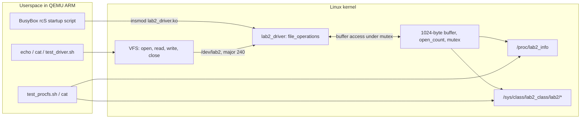

# Lab 02 — Character Device Driver, procfs and sysfs

Implement and integrate a Linux **character device driver** for ARMv7. The code supports `open`, `read`, `write`, and `release`, exposes statistics through `/proc`, and publishes read-only attributes through `/sys`.

## Course information

| Item | Details |
|---|---|
| **Course** | LOS201 |
| **Class** | IC2008 |

## Team members

| No. | Full name | Student ID |
|---:|---|---|
| 1 | Trần Gia Phúc | SE204417 |
| 2 | Trần Hoàng Khôi | SE203155 |
| 3 | Trần Nguyễn Việt Dũng | SE205180 |
| 4 | Thân Trọng Khang | SE203290 |
| 5 | Nguyễn Huy Khánh | SE204207 |

## Block diagram — Character driver and virtual filesystems



`/dev/lab2` is a character-device interface for data, whereas `procfs` and `sysfs` expose driver status. The diagram depicts the interfaces implemented in [`driver/lab2_driver.c`](driver/lab2_driver.c).

## Objectives

- Register a character device with major number **240**.
- Exchange bytes between kernel space and userspace with `copy_to_user()` and `copy_from_user()`.
- Protect driver state with a mutex.
- Expose driver data via `procfs` and `sysfs`.
- Place the module in a BusyBox initramfs and load it on QEMU startup.

## Project layout

```text
lab_2/
├── README.md
├── driver/
│   ├── lab2_driver.c             # Kernel module source
│   └── Makefile                  # ARMv7 out-of-tree Kbuild
├── rootfs/initramfs/
│   ├── etc/init.d/rcS            # Boots and tries to load the driver
│   └── usr/bin/
│       ├── test_driver.sh       # read/write functional test
│       └── test_procfs.sh       # procfs + sysfs test
└── output/
    └── initramfs_lab2.cpio.gz   # Packaged rootfs image
```

Additional BusyBox files, libraries, and generated module-build artifacts are also tracked; they are omitted from this abbreviated tree.

## Driver interface

| Interface | Behavior |
|---|---|
| `/dev/lab2` | Character device, major **240**, minor **0**, 1024-byte internal buffer |
| `read()` | Reads stored data and respects file offset/EOF |
| `write()` | Replaces stored data; truncates writes larger than the available buffer |
| `/proc/lab2_info` | Driver name, major number, buffer size/length, open count, last data |
| `/sys/class/lab2_class/lab2/buffer_len` | Read-only stored length |
| `/sys/class/lab2_class/lab2/open_count` | Read-only count of opens |
| `/sys/class/lab2_class/lab2/last_data` | Read-only last stored value |

The `sysfs` location follows the class and device names in `lab2_driver.c`, not the shorter `/proc/lab2` path shown in the old README.

## Build

The checked-in Makefile uses `ARCH=arm`, `CROSS_COMPILE=arm-linux-gnueabihf-`, and the kernel source at `~/embedded_lab1/kernel/linux-5.15`.

```bash
# From the repository root
cd lab_2/driver
make
# Output: lab2_driver.ko
```

Set `KDIR` inside the Makefile to the path of **your configured Linux 5.15 source tree** when it differs. The compiled module must match the kernel running in QEMU; check `modinfo lab2_driver.ko` and its `vermagic`.

## Boot and test

From the repository root:

```bash
qemu-system-arm \
  -M vexpress-a9 -cpu cortex-a9 -m 512M -nographic \
  -kernel lab_1/output/zImage \
  -dtb lab_1/output/vexpress-v2p-ca9.dtb \
  -initrd lab_2/output/initramfs_lab2.cpio.gz \
  -append 'console=ttyAMA0,115200 root=/dev/ram0 rw rdinit=/linuxrc'
```

The boot command is an example based on the stored images; check the initramfs startup path on your environment.

**Inside QEMU**, the `rcS` script already tries to load `lab2_driver.ko` automatically. First verify that it is loaded:

```sh
lsmod | grep lab2
ls -l /dev/lab2
echo 'Hello, Lab 02' > /dev/lab2
cat /dev/lab2
cat /proc/lab2_info
cat /sys/class/lab2_class/lab2/buffer_len
cat /sys/class/lab2_class/lab2/open_count
cat /sys/class/lab2_class/lab2/last_data
```

Both included scripts call `insmod` themselves. **Do not run them against an already loaded module without unloading it first**:

```sh
rmmod lab2_driver
sh /usr/bin/test_driver.sh
rmmod lab2_driver
sh /usr/bin/test_procfs.sh
```

## Scope and evidence

The committed source and scripts directly document the character driver and procfs/sysfs integration. The original Lab 02 specification also discusses **MTD/JFFS2**, but there is no separate MTD/JFFS2 implementation evident in this checked-in lab folder; this README therefore does not claim that exercise as demonstrated by the repository.

[← Back to repository](../README.md)
