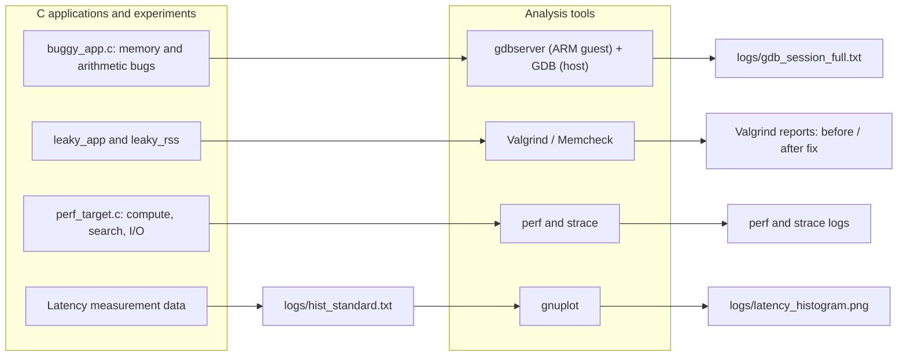
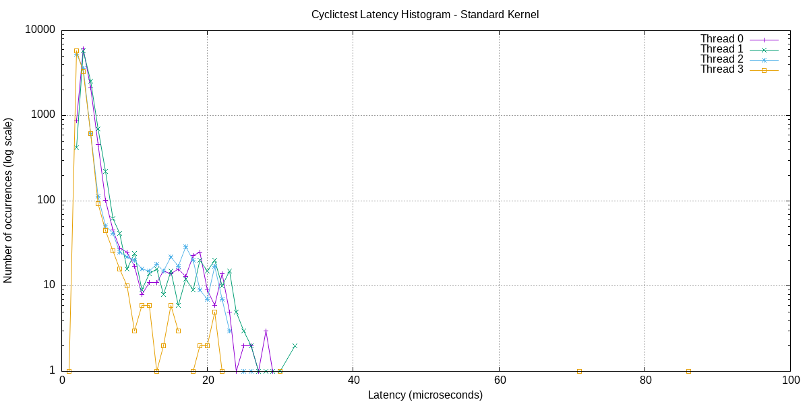

# Lab 03 — Debugging, Profiling and Latency Analysis

Practice diagnosing embedded applications using **GDB**, **Valgrind**, **strace**, **perf**, and timing measurements. The repository includes C examples, ARM binaries, QEMU session records, and captured tool output.

## Course information

| Item | Details |
|---|---|
| **Course** | LOS201 |
| **Class** | IC2008 |

## Team members

| No. | Full name | Student ID |
|---:|---|---|
| 1 | Trần Gia Phúc | SE204417 |
| 2 | Trần Hoàng Khôi | SE203155 |
| 3 | Trần Nguyễn Việt Dũng | SE205180 |
| 4 | Thân Trọng Khang | SE203290 |
| 5 | Nguyễn Huy Khánh | SE204207 |

## Block diagram — Debugging and performance workflow



The workflows are separate experiments; the arrows indicate which tool analyzes which kind of evidence. The top-level `leaky_app.c` is already corrected, while the saved Valgrind logs also document the original leaking run.

## Learning goals

- Inspect invalid memory access and arithmetic bugs with a debugger.
- Detect and correct memory leaks with Valgrind.
- Understand syscall activity and identify CPU-intensive functions.
- Record and visualize latency distributions.

## Repository structure

```text
lab_3/
├── README.md
├── apps/
│   ├── buggy_app.c          # Out-of-bounds, use-after-free, signed overflow
│   ├── leaky_app.c          # Current top-level source has free() fixes
│   ├── leaky_rss.c          # Observe memory usage / RSS
│   └── perf_target.c        # CPU computation, search and file I/O
├── logs/
│   ├── gdb_session.txt
│   ├── gdb_session_full.txt
│   ├── valgrind_report.txt
│   ├── valgrind_fixed.txt
│   ├── strace_summary.txt
│   ├── strace_arm.txt
│   ├── perf_report.txt
│   ├── perf_stat.txt
│   ├── hist_standard.txt
│   ├── latency_histogram.png
│   └── plot_latency.gnuplot
├── output/initramfs_lab3.cpio.gz
└── submit/               # Archived coursework submission files
```

The `apps/` and `rootfs/` folders also contain precompiled executables, BusyBox utilities, and supporting files.

## Rebuild examples (Linux host)

Run from `lab_3/apps`:

```bash
gcc -g -O0 -o buggy_app buggy_app.c
gcc -g -O0 -o leaky_app leaky_app.c
gcc -g -O0 -o perf_target perf_target.c -lm
```

To build an ARM target, choose the compiler/ABI compatible with your QEMU rootfs and installed dynamic linker; for example:

```bash
arm-linux-gnueabihf-gcc -g -O0 -o buggy_app_arm buggy_app.c
```

## Debugging and profiling

### GDB: investigate `buggy_app.c`

Three defects are intentionally illustrated:

| Function | Investigation |
|---|---|
| `process_data()` | Loop condition `i <= len` reads past the array boundary |
| `create_message()` | Returns a pointer after freeing it (use-after-free) |
| `calculate()` | Computes `100000 * 100000` in a signed `int` (overflow) |

A saved remote-debug session records breakpoints in these functions and inspections of the loop index, freed pointer, and calculation result. See [GDB session](logs/gdb_session.txt) and [full session](logs/gdb_session_full.txt). To reproduce a remote session, run `gdbserver` in the QEMU guest and connect from a matching multiarch/ARM GDB on the host; ensure port forwarding or networking is set up before connecting to port 1234.

### Valgrind: before and after fixing leaks

```bash
valgrind --leak-check=full --show-leak-kinds=all ./leaky_app
```

**Important source/version distinction:** the **current** `apps/leaky_app.c` frees its record fields and message buffers; it is already the fixed version. The earlier uncorrected source is preserved under `submit/SE205180_TranNguyenVietDung_Lab03/apps/leaky_app.c`. Do not describe the current top-level file as still leaking.

| Evidence | Recorded result |
|---|---|
| [Original leak report](logs/valgrind_report.txt) | **16,900 bytes definitely lost** in **250 blocks** |
| [After the fix](logs/valgrind_fixed.txt) | **0 bytes in use at exit**, **0 errors** |

These are results from checked-in reports, not from a new test run.

### perf: CPU hotspots

```bash
perf record -g ./perf_target
perf report
perf stat ./perf_target
```

The recorded [perf report](logs/perf_report.txt) attributes **48.26%** of sampled overhead to `__ieee754_log_fma` and **37.18%** to `heavy_compute`. This is consistent with the repeated `log()` and `sqrt()` calls in `perf_target.c`; sample counts and host CPU affect percentages.

### strace: system calls

```bash
strace -c ./perf_target
strace -o /tmp/perf_target.strace ./perf_target
```

The checked-in [strace summary](logs/strace_summary.txt) contains syscall counts and timing for a captured test session; it should be treated as evidence for that run, not a universal benchmark.

### Latency / histogram

The folder includes [raw histogram data](logs/hist_standard.txt), [gnuplot script](logs/plot_latency.gnuplot), and a [generated chart](logs/latency_histogram.png):



## Limitations and takeaways

- Timing, perf samples, and memory consumption vary across host machines and QEMU versions.
- The archived report and log files distinguish **pre-fix** from **post-fix** behavior; the current source should be inspected before rerunning tests.
- `buggy_app.c` intentionally contains unsafe patterns for teaching and must not be reused as production code.

[← Back to repository](../README.md)
